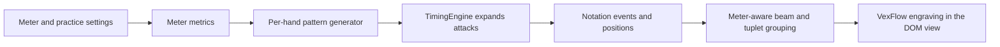
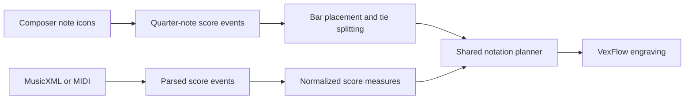

# Rhythm generation and notation flow

The app already separates meter math, practice-pattern generation, score composition, notation grouping, and drawing. There is no single function that performs all five steps: `TimingEngine` coordinates live generated practice, while authored or imported scores enter through a separate score-event path. Both paths converge on the shared notation planner and VexFlow renderer. The main distinction from a full-bar generator is that generated practice chooses a pattern for each configured change interval; it does not independently fill a whole bar with newly selected notes.

## Generated practice

1. **Read the meter.** `src/rhythm/subdivisions.ts` maps each supported `TimeSignature` to a bar's pulse count and its pulse length in quarter notes. `timeSignatureMetrics()` also converts the selected BPM into quarter-note timing. For example, `3/4` has three quarter-note pulses per bar; `6/8` has two dotted-quarter metronome pulses per bar, each 1.5 quarter notes long. The visible beat counter can still show the written eighth-note positions in `6/8`.
2. **Choose the hand patterns.** `createExerciseStepGenerator()` in `src/rhythm/exerciseGenerator.ts` selects a left- and right-hand subdivision, rest, or mixture for each pattern-change interval. It avoids repeating the previous pair when another choice is available and aligns the hands' pattern lengths when possible. A mixture is generated from the configured note/rest values by `src/rhythm/mixtures.ts`; it cannot exceed the configured bar length.
3. **Expand patterns into timed taps.** `TimingEngine.generateThrough()` in `src/rhythm/timingEngine.ts` turns each step into expected attack times. Binary subdivisions divide quarter-note time; tuplets divide the current metronome pulse; mixtures use their written quarter-note durations. The same generated events feed tap matching, scoring, replay, and score display.
4. **Plan notation.** `src/rhythm/noteNotation.ts` maps event onsets and durations to note anchors and engraving geometry. `createNoteNotationPlan()` creates a repeated subdivision symbol; `createRhythmSymbolNotationPlan()` lays out mixtures and rests; `createBarNoteNotationPlan()` lays out a complete bar.
5. **Group and draw.** The notation planner groups beams only when notes are contiguous, have the required beam level, and remain inside the configured beam group. Tuplet labels are formed from contiguous events with the same tuplet count. `src/components/VexFlowNotationDOM.tsx` uses VexFlow for noteheads, stems, flags, beams, rests, dots, and ties. Native React Native views position the rendered notation and add surrounding labels or score layout.

## Composed and imported scores

- The score editor maps note icons to quarter-note durations with `noteValuesForSymbol()` and places them into measures with `composeRhythmScore()` in `src/rhythm/scoreComposer.ts`. Each hand advances independently. Notes crossing a bar line are split into written segments and tied so they remain one scored attack.
- `src/rhythm/musicXmlParser.ts` and `src/rhythm/midiParser.ts` normalize imported material into `ImportedRhythmScore` measures with left/right events.
- `src/rhythm/scoreStaff.ts` converts score events into notation events. `ScoreRhythmMeasure` and `ScoreBeatFocus` provide the bar or beat span and its beam-group length to the same notation planner used by generated practice.

## Meter and grouping rules

The denominator is not a request for that many notes per beat. It specifies the written note unit of the meter; the app then applies the selected subdivision or tuplet to its metronome pulse. For instance, to practise three evenly spaced notes on each quarter-note pulse in a two-beat bar, choose `2/4` and the **Triplet** subdivision. The literal `2/3` time signature is not supported. The currently supported signatures are `2/4`, `3/4`, `4/4`, `5/4`, `7/4`, `2/2`, `3/8`, `6/8`, `9/8`, and `12/8`.

Beam grouping is currently a pulse-boundary policy, not a complete configurable music-theory rules engine. The caller supplies `beamGroupQuarterNotes` (the live practice screen uses the meter's metronome-pulse length); `groupIndexAt()` assigns notes to those groups, and beam runs stop at group boundaries, gaps, or beam-level changes. The renderer splits drawn beams at rests. This handles ordinary pulse grouping and compound dotted-quarter pulses. It does not model custom additive groupings such as `3+2` in `5/8` or `3+2+2` in `7/8` (those signatures are not currently supported either), nor arbitrary hand-authored beam brackets.

For the intended “two beats, three notes on each beat” exercise, select `2/4`, enable **Triplet**, and use a two-beat change interval. That gives each hand six attacks over the same two-quarter-note bar; the notation groups the triplets within each quarter-note pulse. If the interval is one beat, a new pattern may be selected at the next beat instead.

## Useful entry points

| Concern | Module or function |
| --- | --- |
| Supported meter and pulse math | `src/rhythm/subdivisions.ts`: `timeSignatureMetrics()`, `pulseQuarterNotes()` |
| Generated hand patterns | `src/rhythm/exerciseGenerator.ts`: `createExerciseStepGenerator()` |
| Generated expected tap events | `src/rhythm/timingEngine.ts`: `TimingEngine.generateThrough()` |
| Mixture generation | `src/rhythm/mixtures.ts`: `generateMixturePattern()` |
| Score editor placement and ties | `src/rhythm/scoreComposer.ts`: `noteValuesForSymbol()`, `composeRhythmScore()` |
| Beam, note, and tuplet layout | `src/rhythm/noteNotation.ts`: `createBarNoteNotationPlan()` |
| Shared engraving | `src/components/VexFlowNotationDOM.tsx` |

## Screen component boundaries

Route screens own navigation, session state, and composition. Reusable components own a focused display area or interaction. The session provider is a small React context wrapper; `src/store/useSessionController.ts` contains the session lifecycle and timing orchestration.

| Screen or feature | Main components |
| --- | --- |
| Practice | `PracticeStatusBar`, `PracticeRhythmDisplay`, `PracticeTapZones`, `PracticeIntroOverlay`, and `PracticePauseOverlays` |
| Score notation | `ScrollingScoreRhythm` → `ScoreRhythmMeasure` → `ScoreRhythmLane` → `NoteNotation` / `VexFlowNotationDOM` |
| Results and replay | `ResultsOverview`, `ResultsMissedNotes`, `ResultsPerformanceBreakdown`, `ResultsFooter`, and the replay timeline components |
| Exercise practice | `ExerciseHeader`, `ExercisePairPanel`, `ExerciseComposer`, and `ExerciseHistoryPanel` |
| Learn course | `LearnCoursePath`, `LearnLessonTile`, and `LearnPatternPreview` |
| Score import | `ExampleScoreBrowser`, `ScoreLibraryList`, and `ImportedScorePreview` |
| Rhythm settings | `RhythmSettingsOptions` composes meter, pattern, and challenge settings sections |
